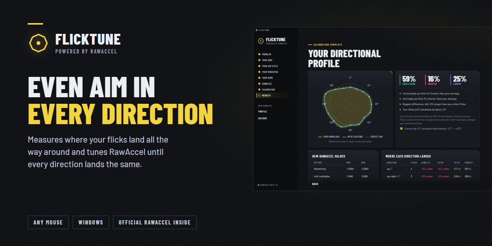
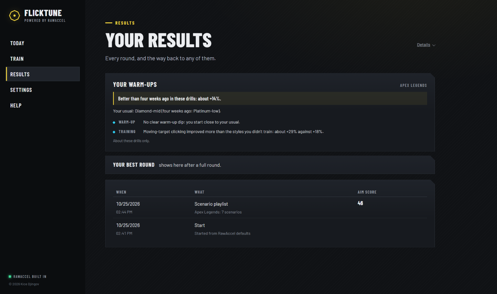
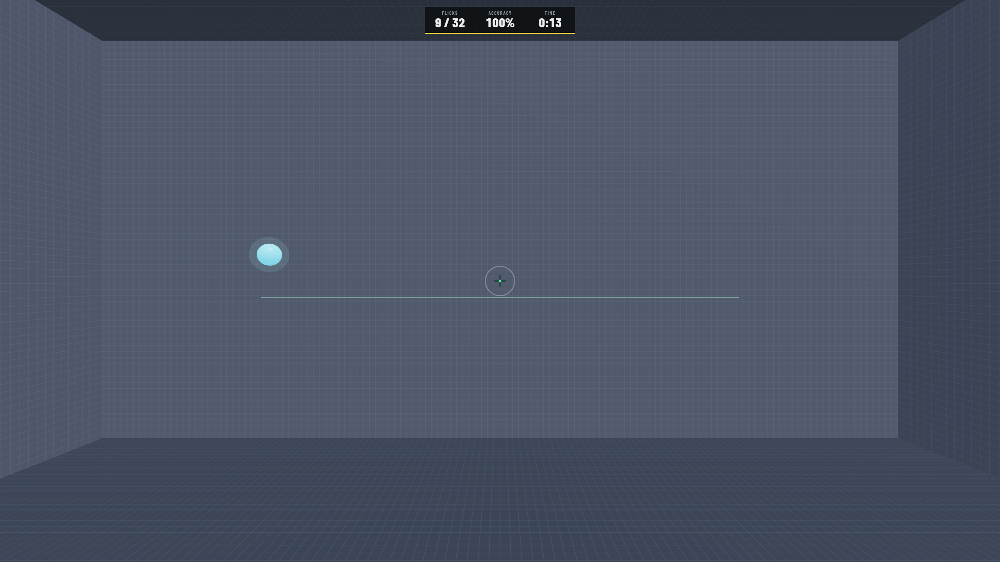
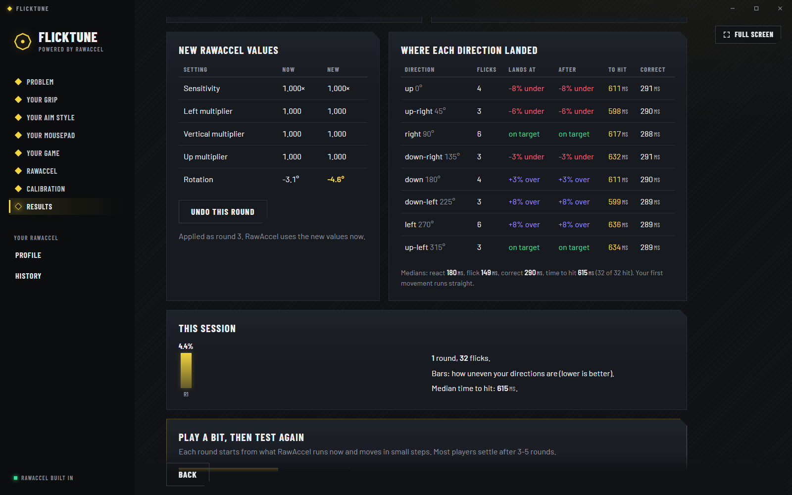
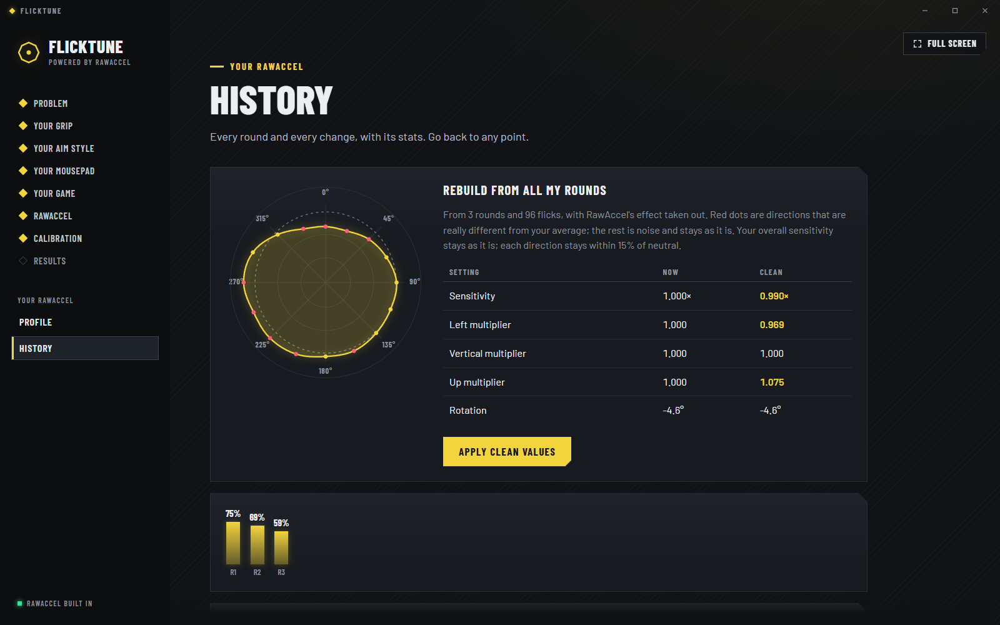
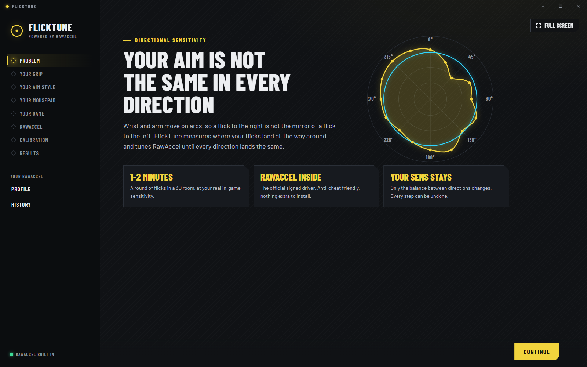
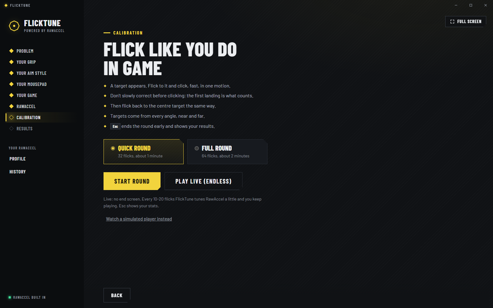
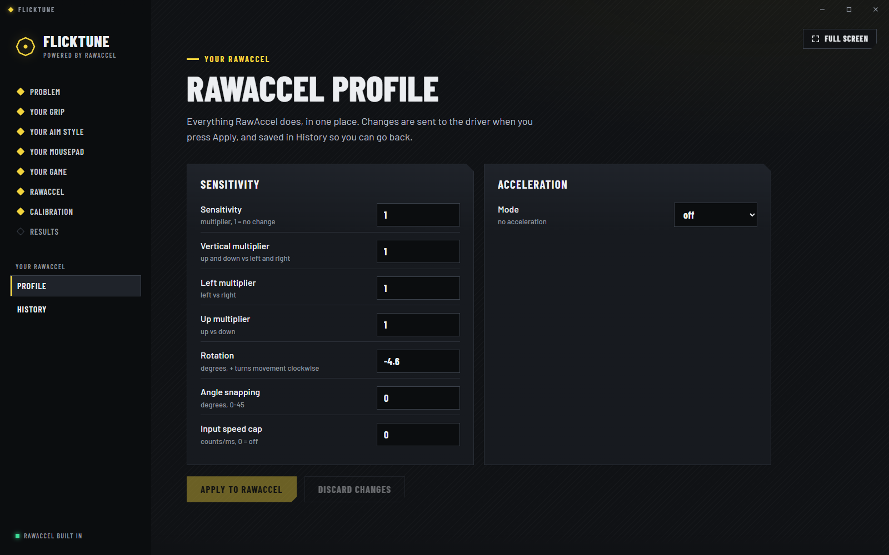

<h3 align="center">
  <a href="https://github.com/kicedz/flicktune-releases/releases/latest">Download FlickTune for Windows</a>
</h3>

Windows 10 / 11 · works with any mouse · updates itself

---

Your wrist and arm move on arcs, so a flick to the right is not the mirror of a flick to the left. Most players
land long in some directions and short in others without knowing it.

FlickTune finds out where. You flick at targets in a 3D room, at your real in-game sensitivity, from every angle.
FlickTune measures how far each flick lands in each direction, then tunes [RawAccel](https://github.com/RawAccelOfficial/rawaccel)
so every direction lands the same. Your overall sensitivity stays exactly what it is.

## How it works

1. **Tell it your game.** Valorant, CS2, Apex, Overwatch 2, Call of Duty or any game by cm/360, plus your DPI.
   The room turns exactly like your game, so your hand makes the same movements.
2. **Flick.** A quick round is 32 flicks (about a minute), a full round 64. Targets come from every angle, near and far.
   Or play live: endless targets, and FlickTune tunes RawAccel every 10-20 flicks while you keep going.
3. **See your aim.** A radar of where your flicks land in every direction, how much shorter or longer each direction is,
   your time to hit, reaction and correction time.
4. **It tunes RawAccel.** Small steps, every one saved in History. Go back to any point, or compare against neutral.

## What it changes, and what it never touches

FlickTune only sets RawAccel's direction balance: left vs right, up vs down, horizontal vs vertical, and a small
rotation. These are fixed multipliers, the same at every speed, so there is **no acceleration** unless you turn it
on yourself. It never changes your overall sensitivity, and each direction stays within 15% of neutral.

  
  

## Questions

**Is it safe with anti-cheat?** FlickTune uses the official, signed RawAccel driver, unchanged. RawAccel is widely used
in competitive games. FlickTune does not read or touch any game; it only changes settings between flicks inside its own
3D room.

**I already have RawAccel.** FlickTune finds it and starts from your current settings, including your acceleration curve.

**I don't have RawAccel.** FlickTune brings it. The first time, it asks to install the RawAccel driver (Windows asks for
admin rights) and you restart once.

**How do I undo everything?** History → *Back to where FlickTune started*. Uninstalling FlickTune keeps RawAccel and its
settings; RawAccel's own uninstaller removes the driver.

**Updates?** FlickTune checks this page on startup and offers new versions. You can turn that off in its settings.

  
  
  

---

**FlickTune © 2026 Kice Djingov. All rights reserved.**

This repository holds installers and update files only. FlickTune includes the official, unchanged RawAccel runtime
(MIT, © a1xd and contributors), three.js (MIT) and the Barlow fonts (OFL); the notices are installed with the app.
