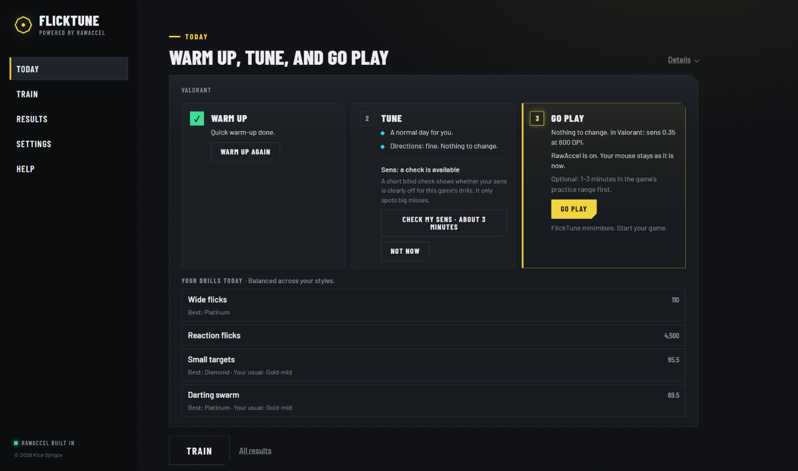
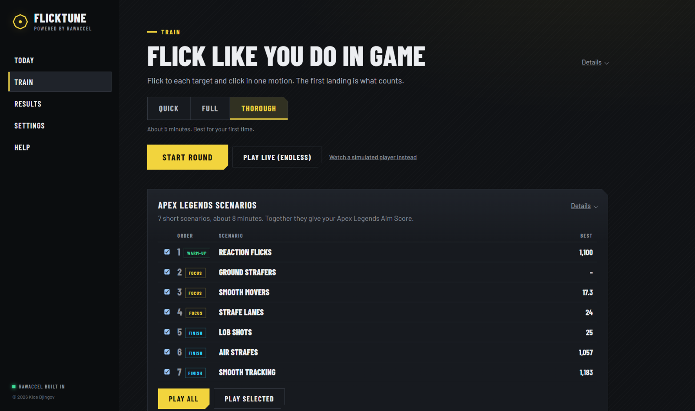
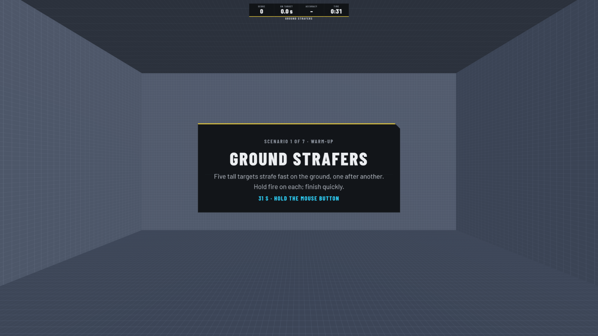
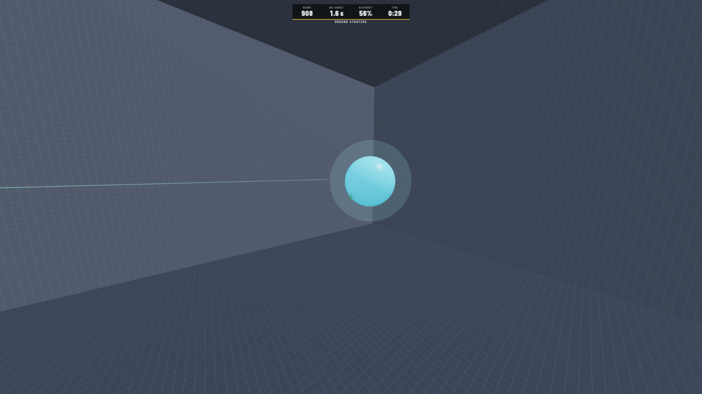

<h3 align="center">
  <a href="https://github.com/kicedz/flicktune-releases/releases/latest">Download FlickTune for Windows</a>
</h3>

Windows 10 / 11 · works with any mouse · updates itself

---

FlickTune is a short routine before you play. Warm up with drills made for your game, see how your aim is today,
then go play. It works with [RawAccel](https://github.com/RawAccelOfficial/rawaccel), and nothing about your
sensitivity changes unless you choose it.

## How it works

1. **Pick your game.** Enter your sens and DPI. The room turns exactly like your game.
2. **Warm up.** Quick or Full, with drills made for your game. Every drill has ranks and personal bests.
3. **Tune.** See how your aim is today and whether anything needs a look.
4. **Go play.**

Want more? **Train** puts your weakest drills first, and **Results** shows how you're doing over the weeks.

  
  
  

## Questions

**Is it safe with anti-cheat?** FlickTune uses the official, signed RawAccel driver, unchanged. It doesn't read or
change any game and doesn't need to be open while you play. Each game and league has its own rules; check them if
you're unsure.

**Does it add acceleration?** No. Your RawAccel curve stays as it is.

**I already have RawAccel.** FlickTune finds it and starts from your current settings, older versions included.

**I don't have RawAccel.** FlickTune brings it. The first time, it asks to install the RawAccel driver (Windows asks
for admin rights) and you restart once.

**How do I undo everything?** Settings → *Back to where FlickTune started*, or *Reset RawAccel*. Every change is in
Results, and you can go back to any point. Uninstalling FlickTune keeps RawAccel and its settings.

**Updates?** FlickTune updates itself in the background. You can turn that off in Settings, or get beta versions a
little earlier.

---

**FlickTune © 2026 Kice Djingov. All rights reserved.**

This repository holds installers and update files only. FlickTune includes the official, unchanged RawAccel runtime
(MIT, © a1xd and contributors), three.js (MIT) and the Barlow fonts (OFL); the notices are installed with the app.
